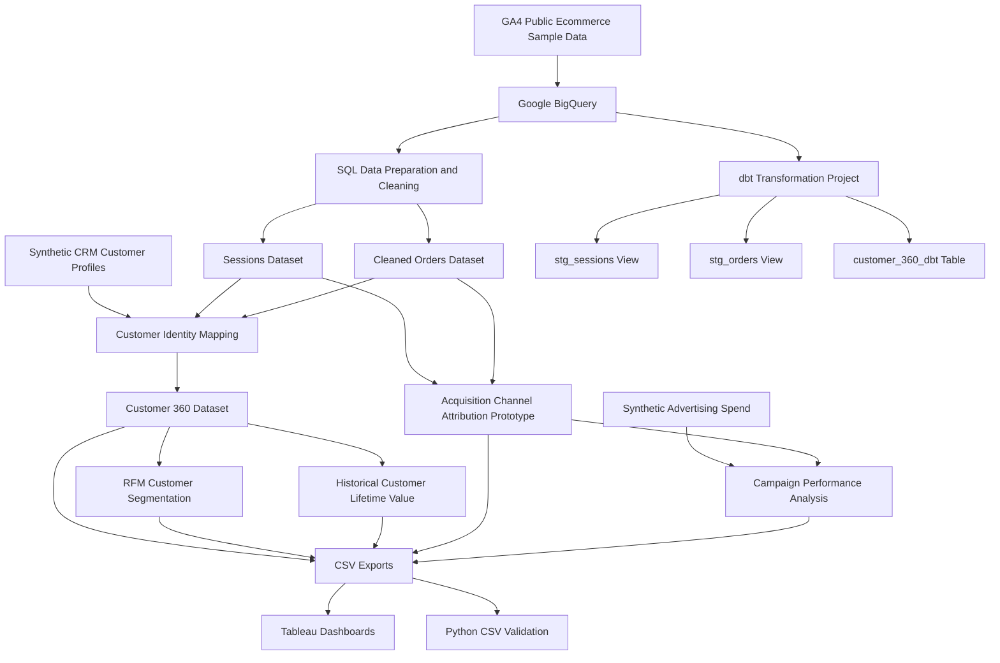
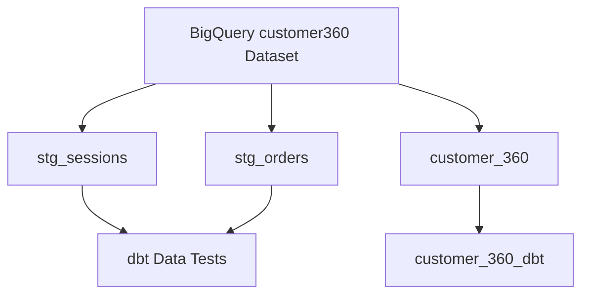

# DA-02 Customer 360 – Architecture Diagram

## 1. End-to-End Data Flow

## 2. Technology Architecture

| Layer | Technology | Purpose |
|---|---|---|
| Data Source | GA4 Sample Dataset | Ecommerce events |
| Data Warehouse | Google BigQuery | Data storage and querying |
| Transformation | SQL | Cleaning and preparation |
| Transformation Framework | dbt Core | Modular models and tests |
| Analytics | SQL | RFM, CLV and attribution |
| Visualization | Tableau | Interactive dashboards |
| Validation | Python | CSV validation |
| Version Control | GitHub | Project management |

## 3. dbt Model Flow

## 4. Important Limitations

- CRM profiles and advertising spend are synthetic.
- Identity mapping is deterministic and does not demonstrate verified cross-device identity resolution.
- Attribution uses first-user acquisition information as a proxy, not full session-level journeys.
- Campaign ROI and CPA cannot be reliably calculated because campaign names do not exactly match.
- The dbt Customer 360 model references an existing BigQuery table rather than rebuilding the entire pipeline.

## 5. Project Outcome

The architecture demonstrates how GA4 sample data, BigQuery, SQL, dbt, Tableau and Python work together in a Customer 360 analytics prototype.